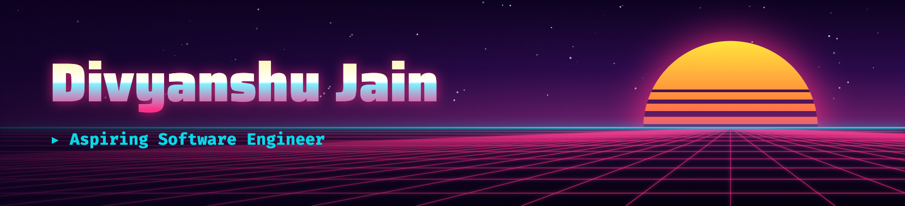

<!-- ==================== PROFILE BANNER ==================== -->

<!-- PROFILE BANNER -->

  

<!-- ==================== INTRODUCTION ==================== -->

# Hey there, I'm Divyanshu Jain 👋

### Aspiring Software Engineer | AI Engineer

 

---

<!-- ==================== ABOUT ME ==================== -->

## 👨‍💻 About Me

<table>
<tr>
<td width="65%" valign="top">

I'm a **pre-final-year B.Tech Computer Science Engineering student specializing in AI & ML**, passionate about building intelligent applications and solving real-world problems through software.

- 🎓 Pursuing B.Tech in Computer Science Engineering with an AI & ML specialization.
- 🧠 Currently learning Data Structures & Algorithms, Generative AI, and Agentic AI.
- 🤖 Exploring AI agents, LLM-powered applications, and intelligent workflows.
- 💻 Interested in Software Engineering and Backend Development.
- 🚀 I enjoy learning new technologies and turning ideas into practical projects.
- 🎯 Seeking Software Engineering and AI Engineering internship opportunities.
- 📈 Focused on continuous learning, problem-solving, and writing better code.

**My goal:** Build impactful software that combines strong engineering fundamentals with the power of AI.

</td>
<td width="35%" align="center" valign="middle">

  

**Building. Learning. Improving.**

 

</td>
</tr>
</table>

---

<!-- ==================== TECH STACK ==================== -->

## 🛠️ Tech Stack

### Languages

  
  
  
  
  

### Backend & Web

  
  
  
  
  

### DevOps & Developer Tools

  
  
  
  
  

### AI & LLM Technologies

  
  
  
  
  
  
  

### Core Concepts

  
  
  
  

---

<!-- ==================== GITHUB STATISTICS ==================== -->

## 📊 GitHub Statistics

  

---

<!-- ==================== CONTRIBUTION ACTIVITY ==================== -->

## 📈 Contribution Activity

<!-- ==================== CONTRIBUTION SNAKE ==================== -->

## 📈 Contribution Graph Animation

<!--
To enable the contribution snake animation:

1. Create a repository named DivyanshuJain2006.
2. Create a GitHub Actions workflow at:
   .github/workflows/snake.yml

3. Add the following workflow:

name: Generate Contribution Snake

on:
  schedule:
    - cron: "0 0 * * *"
  workflow_dispatch:
  push:
    branches:
      - main

permissions:
  contents: write

jobs:
  generate:
    runs-on: ubuntu-latest
    steps:
      - name: Generate Snake
        uses: Platane/snk@v3
        with:
          github_user_name: DivyanshuJain2006
          outputs: |
            dist/github-contribution-grid-snake.svg
            dist/github-contribution-grid-snake-dark.svg?palette=github-dark&color_snake=FF69B4

      - name: Deploy to Output Branch
        uses: crazy-max/ghaction-github-pages@v4
        with:
          target_branch: output
          build_dir: dist
        env:
          GITHUB_TOKEN: ${{ secrets.GITHUB_TOKEN }}

4. Commit and push the workflow.
5. Open the Actions tab and manually run "Generate Contribution Snake".
6. Ensure the workflow has permission to write repository contents.
7. The generated SVG files will be published to the output branch.

The snake image above will work after the workflow successfully generates
the files and publishes them to the output branch.
-->

---

<!-- ==================== CONNECT WITH ME ==================== -->

## 🤝 Connect With Me

I'm always happy to connect with fellow developers, exchange ideas, and explore exciting opportunities.

  

📩 **Email:** divyanshujain1906@gmail.com

💼 **Open to:** Software Engineering Internships | AI Engineering Opportunities

---

<!-- ==================== FOOTER ==================== -->

### 💗 Thanks for visiting my profile!

*Learning something new every day. Building something better every step of the way.*

 

